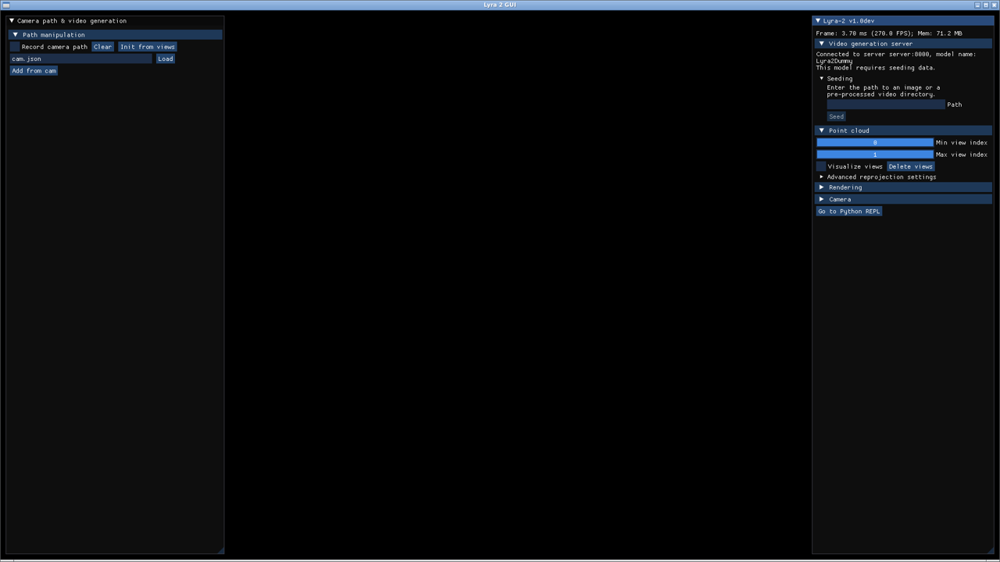
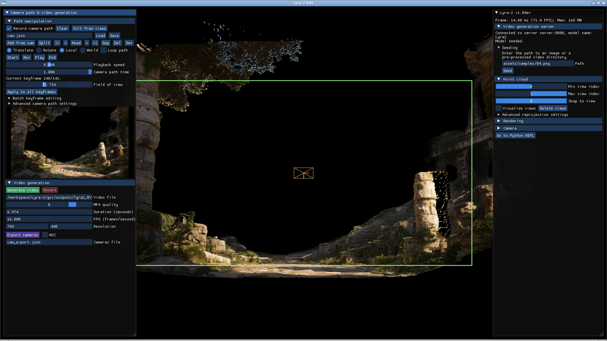

# Lyra 2.0 CLI inference in Docker (DGX Spark, aarch64)

A self-contained image for the README Step 1 / Step 2 inference commands on a DGX Spark. The
Dockerfile clones the Lyra source itself (pinned commit plus the VIPE and Depth-Anything-3
submodules) and replays the verified host recipe in
[INSTALL_DGX_SPARK.md](INSTALL_DGX_SPARK.md), Steps 1 to 7. Nothing from a local conda
environment or a local checkout is used: this `docker/` directory is the whole build input.
Model weights, sample images and outputs stay on the host and are bind-mounted.

Contents:

- `Dockerfile` — stage 1 clones `https://github.com/nv-tlabs/lyra` at `LYRA_REF` (sparse checkout
  of `Lyra-2/`, two inference submodules, git metadata stripped). Stage 2: Miniforge + conda env
  `lyra2` (Python 3.10, GCC 13.3, Eigen 3.4, CUDA 13.0.2), torch 2.9.1+cu130, pinned requirements
  with the aarch64 substitutions, MoGe, Transformer Engine 2.20.2, flash-attn 2.8.3.post2 built
  for `sm_120`, VIPE and Depth Anything 3 with gsplat, then an import self-check.
- `entrypoint.sh` — resolves the checkpoints, then dispatches `zoomgs`, `custom`, `recon`,
  `server`, `sync-assets`, or any other command.
- `build.sh` — creates the host directories, builds the image, then runs `sync-assets` once.
- `download_weights.sh` — fetches the Lyra 2.0 checkpoints, the Qwen3-VL captioner and the
  run-time Hugging Face cache items into the directories compose mounts (see "Downloading the weights").
- `compose.yml` — build arguments, mounts and GPU reservation.
- `Dockerfile.dockerignore` — keeps this README, `.env` and the host data directories
  (`assets/`, `outputs/`, `checkpoints/`) out of the build context.
- `LICENSE` — Apache License 2.0 for this repository; see "License and third-party content" below.

## Build

```bash
./build.sh                       # creates ./assets, builds lyra2-dgx-spark:latest, syncs the cloned assets into ./assets
./build.sh --no-cache            # arguments are passed to `docker compose build`
LYRA_REF=main ./build.sh         # any commit/branch/tag of nv-tlabs/lyra
```

`docker compose build` alone also works, but then `./assets` stays empty until you run
`docker compose run --rm lyra2 sync-assets` yourself.

No GPU is needed to build, and no local Lyra checkout or conda environment is used. The CUDA
extensions are compiled for `sm_120`, which the GB10 (`sm_121`) executes. `MAX_JOBS` (default 8)
caps parallel nvcc jobs because the 128 GB is shared with the GPU. Expect 30 to 60 minutes; the
pip cache is kept in a BuildKit cache mount, so rebuilds after changing `LYRA_REF` only redo the
steps from Step 7 onward. The commit that was built is recorded in `/workspace/Lyra-2/SOURCE_REVISION`
inside the image and printed by the self-check at the end of the build.

## Run the R7 inference task

```bash
docker compose run --rm lyra2                       # sample 4, zoom preset, --use_dmd
SAMPLE_ID=7 docker compose run --rm lyra2           # another sample from assets/samples
docker compose run --rm lyra2 zoomgs --sample_id 2 --num_frames_zoom_out 161   # any flag of lyra2_zoomgs_inference
docker compose run --rm lyra2 recon --input_video_path outputs/zoomgs/videos/04.mp4
docker compose run --rm lyra2 bash
```

Flags given after `zoomgs` are appended after the defaults, so they override them (argparse keeps
the last value). Outputs land in the host output directory exactly as in the native run.

Verified on a DGX Spark on 2026-10-19: the default command produced a `videos/04.mp4`
byte-identical to the native (non-Docker) run, in 29.5 minutes wall-clock (about 2.5 minutes of
model loading, about 26.5 minutes generating 322 frames with DMD).

## Downloading the weights

```bash
./download_weights.sh                 # Lyra 2.0 checkpoints (~97 GB) + Qwen3-VL-4B (~8 GB, GUI server) + run-time cache (~1.2 GB)
./download_weights.sh --skip-qwen     # CLI inference only
./download_weights.sh --recon-priors  # also prefetch the DA3 depth priors used by Step 2 reconstruction
./download_weights.sh --dry-run       # show targets and commands only
```

The script fills exactly the directories compose mounts: `LYRA_CHECKPOINTS_DIR` (default
`./checkpoints`) receives `nvidia/Lyra-2.0`'s `checkpoints/*` tree (`model/`, `recon/`,
`text_encoder/`, `vae/`, `image_encoder/`, `lora/`) plus `qwen/Qwen3-VL-4B-Instruct/`, and
`HF_HOME` (default `~/.cache/huggingface`) receives the files the inference code fetches on its own
at run time (the `google/umt5-xxl` tokenizer and the `Ruicheng/moge-vitl` weights), so the
containers can run without network access. Downloads resume and existing files are skipped. It
uses the `hf` CLI if installed, otherwise the one inside the built image via `docker run`, so
Docker is the only host requirement. Set `HF_TOKEN` in `.env` if the hub requires it.

## Where the models come from

`entrypoint.sh` resolves `/workspace/Lyra-2/checkpoints` (which the inference code hard-codes as
`checkpoints/model`, `checkpoints/lora/...`, `checkpoints/text_encoder/negative_prompt.pt`, and so
on) in this order:

1. `LYRA_CHECKPOINTS_DIR` inside the container, if set.
2. `/models/checkpoints`, if it contains a `model/` directory. The compose file bind-mounts the
   host `LYRA_CHECKPOINTS_DIR` (default `./checkpoints`) there, read-only.
3. The Hugging Face cache mounted at `/cache/huggingface` (`HF_HOME`). This is the default when
   nothing is mounted at `/models/checkpoints`: the entrypoint looks for a cached snapshot of
   `nvidia/Lyra-2.0` with `checkpoints/*`. Populate it on the host with
   `hf download nvidia/Lyra-2.0 --include "checkpoints/*"` (no `--local-dir`), or let the
   container do it once with `LYRA_HF_DOWNLOAD=1 docker compose run --rm lyra2` (about 97 GB;
   set `HF_TOKEN` if the repo requires it).

The Hugging Face cache is always mounted because the inference code also fetches small things
through it at run time: the `google/umt5-xxl` tokenizer and the `Ruicheng/moge-vitl` weights
(about 1.2 GB). With a populated cache mounted, the container needs no network. `TORCH_HOME` is
mounted for the same reason (VIPE's `torch.hub` depth priors).

## Assets (samples, trajectories) and outputs

The host directory `LYRA_ASSETS_DIR` (default `./assets`) is mounted read-write at
`/workspace/Lyra-2/assets`, the path the inference code reads (`assets/samples`,
`assets/custom_trajectory_examples`). The image keeps a pristine copy of the cloned
`Lyra-2/assets` at `/opt/lyra2/assets-default`; `sync-assets` copies into the host directory every
file and directory from that copy that does not already exist there, and never overwrites. So:

- after the first `./build.sh`, `./assets/` holds the upstream samples and trajectory
  examples (36 files), owned by your user, ready to inspect or edit; the directory is
  git-ignored (it is upstream content, recreated by `build.sh`), so keep your own additions backed
  up elsewhere or point `LYRA_ASSETS_DIR` at a directory you manage;
- your edits and additions persist across builds and syncs (existing files are never touched;
  verified by editing a caption, re-syncing, and finding it unchanged);
- after a rebuild at a newer `LYRA_REF`, re-running `./build.sh` (or
  `docker compose run --rm lyra2 sync-assets`) adds any new upstream files without disturbing yours.

Add `<id>.png` + `<id>.txt` pairs under `assets/samples` and select them with `SAMPLE_ID`
or `--sample_id`; no rebuild is needed. The sync is deliberately not run at container start.
`LYRA_OUTPUT_DIR` (default `./outputs`, created by `build.sh`) is mounted at `outputs`; CLI
runs write `zoomgs/`, `custom_traj/`, ... there and the GUI server writes `gui_sessions/`.

## Using other host locations

The defaults (`./assets`, `./outputs`, `./checkpoints`, `~/.cache/huggingface`) are relative
to this repository root. To keep data elsewhere, put the paths in a `.env` file next to
`compose.yml` (compose and `build.sh` read it automatically):

```ini
LYRA_CHECKPOINTS_DIR=/data/lyra/checkpoints
LYRA_ASSETS_DIR=/data/lyra/assets
LYRA_OUTPUT_DIR=/data/lyra/outputs
HF_HOME=/data/hf-cache
```

`./build.sh` reads `.env`, creates `LYRA_ASSETS_DIR` and fills it from the cloned source; an empty
`LYRA_CHECKPOINTS_DIR` triggers the Hugging Face cache fallback described above.

## Interactive GUI in the browser

The image also contains the native viewer (`pyngp`, built with the three GUI patches from
INSTALL_DGX_SPARK.md) and an in-container display stack, so the GUI can be used from any browser
without touching the host's desktop (Design 1 in [docs/GUI_WEB_SERVING.md](docs/GUI_WEB_SERVING.md)):

```bash
docker compose --profile gui up server gui                 # inference server + viewer
LYRA_GUI_DUMMY=1 docker compose --profile gui up server gui   # no weights: protocol/viewer smoke test
# then open  http://<spark>:6080/   (connects automatically; set LYRA_VNC_PASSWORD=... for a password prompt)
docker compose --profile gui down
```

How it works: the `gui` service starts its own Xorg on the GB10 using the NVIDIA X driver that the
container runtime injects (`NVIDIA_DRIVER_CAPABILITIES=all`), on a monitor-less virtual screen
(`LYRA_GUI_SCREEN`, default `1920x1080`), with `-novtswitch -sharevts` so it never touches the
host's virtual terminals or its GDM session. `openbox` manages the window, `x11vnc` captures the
screen and injects browser mouse/keyboard through XTEST, and noVNC/websockify serve the page on
`LYRA_NOVNC_PORT` (default 6080). The served `vnc.html` is a copy patched to connect on load
(it adds noVNC's `autoconnect=true`, `resize=scale` and `reconnect=true` URL parameters when
opened bare; your own parameters are respected), and `/` redirects to it. `resize=scale` fits the
1920×1080 screen to the browser window; use `vnc.html?autoconnect=true&resize=off` for 1:1 pixels. The viewer is `gui/api/client.py` unchanged, pointed at the
`server` service over the compose network. Everything in the native GUI works from the browser;
only VR mode and drag-and-drop from your own machine do not (type a server-side path into the
Seeding box: `assets/samples/00.png`). The `server` service needs the Qwen weights under
`checkpoints/qwen/Qwen3-VL-4B-Instruct` and loads ~95 GB at start; its `LYRA_GUI_*` settings are
passed through from the environment. Start-up ordering: `server` has a health check on
`/metadata` (with a 30-minute grace period for weight loading) and `gui` depends on it being
healthy; independently, the `gui` entrypoint polls `/metadata` before launching the viewer
(`LYRA_SERVER_WAIT_S`, default 3600 s), so the viewer never races the model load. While waiting,
the browser shows the empty X screen; the viewer window appears once the server answers.

Timings measured on the GB10: the real server answers `/metadata` about 3 minutes after start;
the first **Seed** of a 1280×720 image took 14.5 minutes (the GPU was busy throughout: depth
estimation, scale alignment and spatial-cache initialisation on the full model; the dummy server
seeds instantly). During such a request the single uvicorn worker is occupied, so the compose
health check (which only gates start-up) may report `unhealthy` for a while; that is expected and
the retry budget is sized so it does not matter.

Security: only the noVNC port is published, with no VNC password by default. Use an SSH tunnel
(`ssh -N -L 6080:127.0.0.1:6080 <spark>`) or set `LYRA_VNC_PASSWORD` before exposing it.

Verified on the DGX Spark on 2026-10-20 with `LYRA_GUI_DUMMY=1`: the container's Xorg loaded the
NVIDIA driver on the GB10 (`Virtual screen size configured to be 1920 x 1080`), the viewer
initialised OpenGL 4.6 on it and ran at ~300 FPS, noVNC answered on port 6080, and input injected
through XTEST (the path VNC uses) ticked a checkbox, typed `assets/samples/00.png` into the Seeding
box and clicked **Seed**, which produced a `POST /seed-model` on the server and a seeded scene in
the viewer. One detail for anyone scripting the GUI with `xdotool`: this ImGui snapshot drops a
press and release that land in the same frame, so use `mousedown`, a short sleep, then `mouseup`;
human clicks through VNC are never that fast. The Xorg log lines about missing `mouse`/`kbd`/
`libinput` input drivers and the D-Bus socket are expected on a device-less screen.

## Gallery

Everything below was produced on a DGX Spark with this image (`docs/` holds the files).

**Input: sample 04** (`assets/samples/04.png`, 1280×720, with its caption `04.txt`):


> *A cinematic drone shot glides forward through the center of a sun-drenched, ancient stone
> amphitheater. The weathered limestone blocks, crumbling arches, and de…* (full text in
> [docs/sample-04-caption.txt](docs/sample-04-caption.txt))

**Output of `docker compose run --rm lyra2`** (R7 defaults: zoom-in 81 frames, zoom-out 241
frames, `--use_dmd`; 322 frames at 832×480, 29.7 minutes on the GB10). Inline preview at 6 fps;
the full video is [docs/sample-04-output.mp4](docs/sample-04-output.mp4):


**The GUI served to the browser** (`docker compose --profile gui up server gui`, screen captures
of the container's display, which is exactly what noVNC shows):

| Viewer connected, before seeding | Seeded with sample 04 on the real server |
|---|---|
|  |  |

Right: the seed image lifted to a point cloud by the server's depth estimate, the camera gizmo,
and a camera path being recorded (the **Record camera path** box was ticked for the capture;
140 keyframes shown at the top left). [docs/gui-seeded-dummy.png](docs/gui-seeded-dummy.png)
shows the same flow with `LYRA_GUI_DUMMY=1`, where the server returns a 96×64 placeholder
instead of a real depth estimate; useful to recognise a dummy-mode session.

Small quirk seen while capturing: immediately after **Seed** completes, the viewer window can
stay black until the next mouse movement over it, after which it renders normally. In a browser
session that happens on its own as soon as the cursor moves.

## License and third-party content

Copyright 2026 g0blinResearch / James Hooker. This repository is licensed under the
[Apache License 2.0](LICENSE). It redistributes no model
weights and no Lyra source code; the Dockerfile clones Lyra at build time and `download_weights.sh`
fetches the weights from Hugging Face, where the downloader accepts the respective terms. Some
content here is nevertheless derived from or produced with third-party work:

| What | Origin | Terms |
|---|---|---|
| `INSTALL_DGX_SPARK.md` | adapted step by step from Lyra 2.0's `INSTALL.md`, with its commands quoted and modified | Apache-2.0, Copyright (c) 2026 NVIDIA CORPORATION & AFFILIATES |
| `docs/sample-04-input.png`, `docs/sample-04-caption.txt` | copies of `assets/samples/04.png` / `04.txt` from the Lyra 2.0 repository | Apache-2.0 (NVIDIA); upstream states that some sample images are sourced from the [Tanks and Temples](https://www.tanksandtemples.org/) benchmark and from [Marble](https://marble.worldlabs.ai/) by World Labs, whose own terms then apply |
| `assets/` (created locally by `build.sh`) | synced from the cloned `Lyra-2/assets`; **not committed** (`.gitignore`) | as above |
| The `sed` patches in the `Dockerfile` | modify three Lyra 2.0 GUI source files at build time; the modified files exist only inside the built image | Apache-2.0 (NVIDIA), modifications marked by the patch comments |
| `docs/sample-04-output.mp4`, `docs/sample-04-output.gif`, `docs/gui-seeded-*.png` | generated with the Lyra 2.0 model weights (the screenshots also show the seeded point cloud) | the weights are released under the [NVIDIA Internal Scientific Research and Development Model License](https://www.nvidia.com/en-us/agreements/enterprise-software/nvidia-internal-scientific-research-and-development-model-license/); that license governs use of outputs |
| `docs/GUI_WEB_SERVING.md`, `docs/gui-startup.png` | written / captured for this repository; the screenshots show Lyra 2.0's GUI | Apache-2.0 (this repository) |

If you publish the **built image** rather than this recipe, note that the image additionally
contains Lyra 2.0 (Apache-2.0), the conda-forge `ffmpeg` GPL build, `x11vnc` and `openbox`
(GPL-2.0), noVNC (MPL-2.0) and many other packages, with their own redistribution obligations.
The NVIDIA driver libraries are injected by the container runtime at start and are not part of the
image.

## Acknowledgements

This repository was made with the assistance of Fable (Claude Fable 5.1, Anthropic). Before
involving Fable we had taken the DGX Spark deployment as far as we could by hand, and had run into
complex dependency problems: some packages were over-pinned, and the pins produced API
incompatibilities between Python libraries on this platform. Fable researched the aarch64 /
CUDA 13 / `sm_121` constraints, worked through the dependency stack step by step, and wrote
`INSTALL_DGX_SPARK.md`, the Docker recipe and the accompanying studies. The browser-served GUI
(the in-container NVIDIA X screen, x11vnc and the auto-connecting noVNC page) was done entirely
by Fable.

## Notes

- The inference containers run as the host user (`UID`/`GID`, default 1000) so outputs are not
  root-owned. Export `UID=$(id -u) GID=$(id -g)` if yours differ. The `gui` service runs as root
  because Xorg requires it; it only writes to `outputs/` if you pass `--output-dir` in
  `LYRA_CLIENT_ARGS`.
- `ipc: host` and the memlock/stack ulimits are the usual settings for PyTorch containers.
- `WITH_GUI=0` as a build argument skips the viewer build (smaller image, CLI inference only).
- The DA3 lazy-import patch (pycolmap has no aarch64 wheel) is applied inside the image.
- `PYTORCH_CUDA_ALLOC_CONF` prints a deprecation notice under torch 2.9; it still takes effect.
